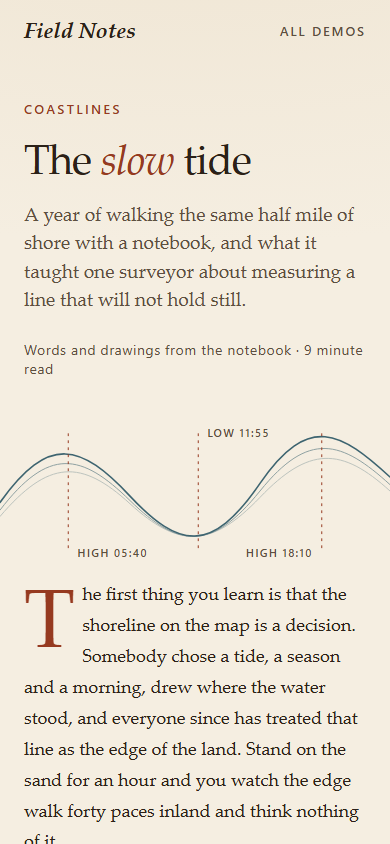

# Experience demos

Three sample products built from the same six recipes (`shared/creative/recipes/`) and the same
quality runtime, each made to look and behave like itself. They exist to show that the toolkit
adapts to a product instead of stamping one look on everything, and to give the bench and the
audit something real to measure. All content is sample data written for these pages.

Open `index.html` from disk (no server, no build, no dependencies). Add
`?quality=static|low|balanced|high|ultra` to any demo to hold a tier.

| | Signal | Field Notes | Lantern |
|---|---|---|---|
| Job | Operate: service health console | Read: long essay | Persuade: landing page |
| Type | Grotesque and mono | Old-style serif | Condensed display |
| Colour | Cool slate, blue accent, status colours with a legend and shapes | Warm paper, oxblood accent | Violet night, ember accent |
| Recipes | spring-states, route-transition | scroll-reveal, spring-states, cursor-light | flow-hero, magnetic-target, cursor-light, scroll-reveal |
| Interaction | A row opens to detail and back (Enter, Esc, tap), deep-linkable | Footnotes open in place | A slider moves the sky from dusk to dawn |
| Cost at rest | No frames requested | No script frames; scroll effects run in CSS | One shader, tiered; a still gradient on `static` and with reduced motion |

## Screenshots

Real captures from `audit-design` (headless Chromium, 1440×900 and 390×844), not mock-ups.

| | Dark | Light | Phone |
|---|---|---|---|
| Signal |  |  |  |
| Field Notes |  |  |  |
| Lantern |  |  |  |

`screenshots/` also holds the other phone theme for each demo.

## Measured

Lab numbers, not field data. `audit-design` bench, 3 runs per tier, medians; desktop 1440×900,
dark theme, no CPU or network throttling; headless Chromium 153 on Windows 11, Core i7-10750H.
**The renderer is SwiftShader (software, no GPU)**, which is far slower at shaders than any real
graphics chip, so Lantern's frame times here are a worst case and only the comparison between
tiers is meaningful. INP is unknown: no interaction was scripted in these runs. Vitals come from
the browser's own PerformanceObserver (`web-vitals` is optional and was not installed).

| Demo | Tier | LCP ms | CLS | Long tasks ms | Frame p50 ms | Frame p95 ms | Transfer KB | Script KB | Requests |
|---|---|---|---|---|---|---|---|---|---|
| Signal | every tier | 92–108 | 0 | 0 | 16.7 | 16.7–16.8 | 40.9 | 15.5 | 5 |
| Field Notes | every tier | 92–124 | 0 | 0 | 16.7 | 16.7–16.8 | 39.8 | 17.5 | 7 |
| Lantern | static | 168 | 0 | 0 | 16.7 | 16.7 | 53.1 | 28.9 | 12 |
| Lantern | low | 168 | 0 | 105 | 16.7 | 33.3 | 53.1 | 28.9 | 12 |
| Lantern | balanced | 172 | 0 | 91 | 33.3 | 33.4 | 53.1 | 28.9 | 12 |
| Lantern | high | 192 | 0 | 1363 | 50.0 | 50.1 | 53.1 | 28.9 | 12 |
| Lantern | ultra | 224 | 0 | 3994 | 66.7 | 83.4 | 53.1 | 28.9 | 12 |
| Lantern | automatic (starts on high) | 176 | 0 | 1068 | 50.0 | 50.1 | 53.1 | 28.9 | 12 |

What the numbers say:

- Signal and Field Notes cost the same on every tier because neither runs a frame loop; the tiers
  only matter to Lantern.
- On this software renderer Lantern holds 60 fps on `static` and (at the median) `low`, 30 fps on
  `balanced`, and misses on `high` and `ultra`. That is what the tiers are for.
- Left on automatic, the runtime started Lantern on `high`, stepped to `balanced` at about 4.2 s
  and to `low` at about 7.8 s (one probe run). The bench window is shorter than that, so the
  "automatic" row above shows the page before it adapts, not after.
- Not measured: a real GPU, phones, Safari, Firefox, INP, throttled CPU or network.

Reproduce (needs a folder with Playwright installed):

```
node skills/audit-design/scripts/visual-audit.mjs --url file:///<path>/demos/experience/lantern.html \
  --project <folder-with-playwright> --out <dir> --viewports desktop=1440x900 --themes dark \
  --perf --tiers default,static,low,balanced,high,ultra --runs 3
```

## Checked

`tests/experience-demos.test.mjs` (real browser; set `PLAYWRIGHT_PROJECT`) covers: every demo on
every tier in both themes without errors; no sideways scroll on a phone; the three demos share
no typeface, background or accent; keyboard open/close with focus following (Signal); a deep
link and reduced motion (Signal); tap on touch (Signal, Lantern); footnotes and end-of-page
visibility (Field Notes); no frames at rest; no layout shift on a slowed processor (Signal); the
shader absent on `static` and with reduced motion and stopped the moment the hero leaves the
screen (Lantern).

`audit-design` passes on all three at both sizes and both themes with no blocker, major or minor
finding. Its remaining notes are text over gradients whose contrast a script cannot measure;
those were checked by eye in the screenshots.

## Framework neutrality

The demos are plain HTML, CSS and script on purpose. The recipes they use are the same files a
React, Vue or Svelte project would import; `shared/creative/recipes/adapters.md` shows the
wrapper patterns, which are documented patterns and have not been run inside those frameworks.
