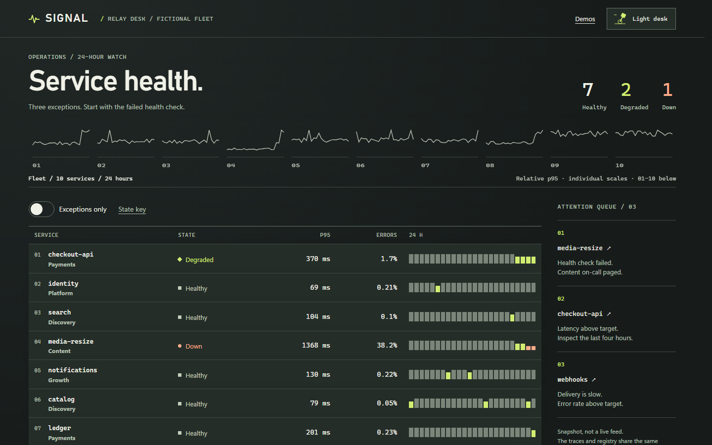
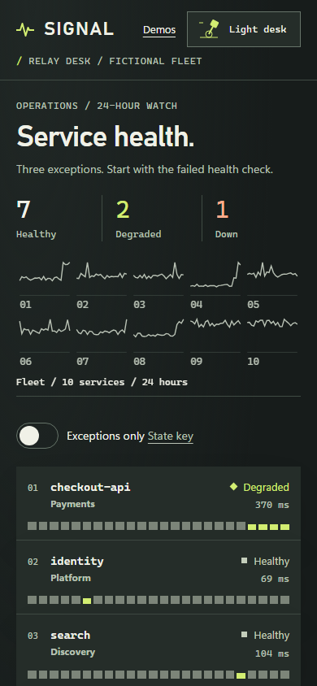
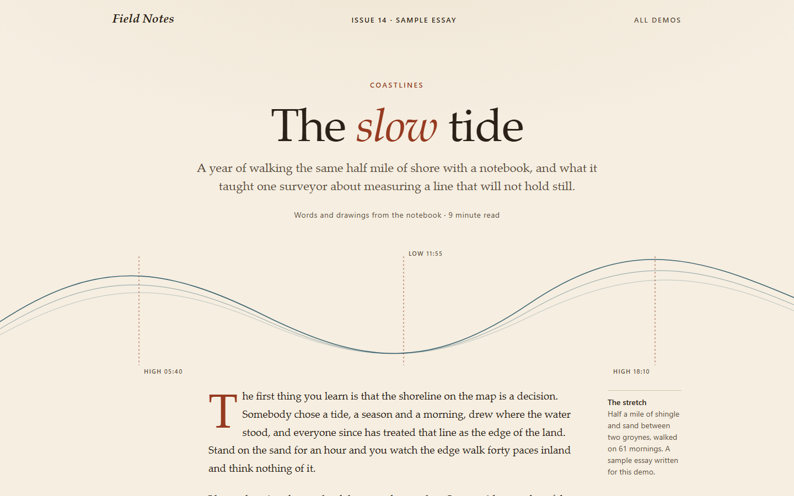
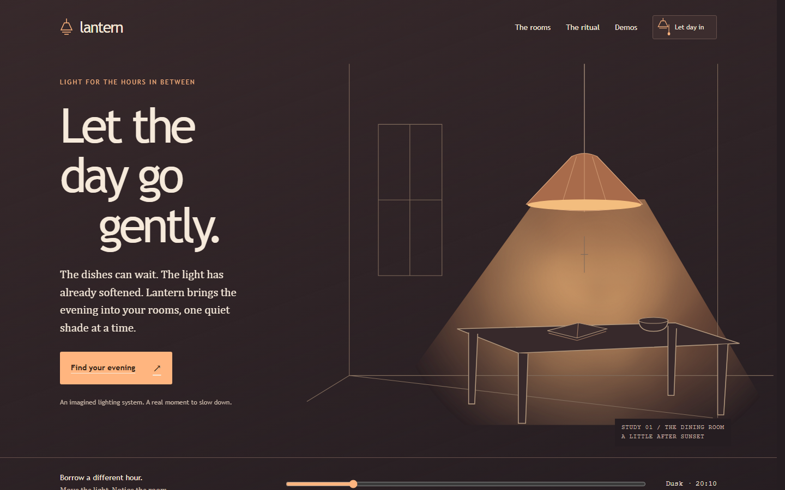

# Experience demos

Three sample products built from the same six recipes (`shared/creative/recipes/`) and the same
quality runtime, each made to look and behave like itself. They exist to show that the toolkit
adapts to a product instead of stamping one look on everything, and to give the bench and the
audit something real to measure. All content is sample data written for these pages.

Open `index.html` from disk (no server, no build, no dependencies). Add
`?quality=static|low|balanced|high|ultra` to any demo to hold a tier.

| | Signal | Field Notes | Lantern |
|---|---|---|---|
| Job | Operate: service health console | Read: long essay | Persuade: landing page |
| Type | Grotesque and mono | Old-style serif | Condensed display |
| Colour | Cool slate, blue accent, status colours with a legend and shapes | Warm paper, oxblood accent | Violet night, ember accent |
| Recipes | spring-states, route-transition | scroll-reveal, spring-states, cursor-light | flow-hero, magnetic-target, cursor-light, scroll-reveal |
| Interaction | A row opens to detail and back (Enter, Esc, tap), deep-linkable | Footnotes open in place | A slider moves the sky from dusk to dawn |
| Cost at rest | No frames requested | No script frames; scroll effects run in CSS | One shader, tiered; a still gradient on `static` and with reduced motion |

## Screenshots

Real captures from `audit-design` (headless Chromium, 1440×900 and 390×844), not mock-ups.

| | Dark | Light | Phone |
|---|---|---|---|
| Signal |  |  |  |
| Field Notes |  |  |  |
| Lantern |  |  |  |

`screenshots/` also holds the other phone theme for each demo.

## Measured

Lab numbers from one laptop, not field data and not real phones. `audit-design` bench in a
**headed Chromium 153 window with hardware acceleration** (renderer: ANGLE, NVIDIA GeForce RTX
2070 Super with Max-Q, Direct3D 11), Windows 11, Core i7-10750H, 16 GB, a display refreshing
about 300 times a second (one frame is 3.3 ms). Each cell is 5 runs unless it says otherwise,
shown as median (lowest–highest). INP comes from a scripted session per demo
(`scripts/<demo>.json`: open and close a row with mouse and keyboard, filter, scroll, open
footnotes, drag the slider, tap on the phone viewport). "Phone viewport" is a 390×844 touch
viewport in the same desktop browser: it checks layout and touch handling and says nothing
about a phone's processor or GPU. CLS was 0 in every cell except one run noted below. Measured
2026-11-15.

| Demo | Condition | LCP ms | INP ms |
|---|---|---|---|
| Signal | desktop light | 136 (108–168) | 16 (16–16) |
| Signal | desktop dark | 140 (104–160) | 16 (16–32) |
| Signal | phone viewport light | 120 | 24 (16–24) |
| Signal | phone viewport dark | 120 | 16 (16–24) |
| Signal | reduced motion (runs as `static`) | 140 (132–148) | 24 (24–56) |
| Signal | processor slowed 4×, desktop | 516 (460–604) | 72 (64–80) |
| Signal | processor slowed 4×, phone viewport | 1052 (504–1256) | 120 (104–136) |
| Signal | slow 4G, phone viewport (3 runs) | 1460 (1348–1532) | 56 (40–56) |
| Field Notes | desktop light | 168 (128–252) | 16 (16–16) |
| Field Notes | desktop dark | 160 (148–188) | 16 (16–24) |
| Field Notes | phone viewport light | 172 (144–264) | 32 (24–56) |
| Field Notes | phone viewport dark | 132 (124–192) | 32 (32–56) |
| Field Notes | reduced motion (runs as `static`) | 128 (112–156) | 16 |
| Field Notes | processor slowed 4×, desktop | 768 (652–868) | 32 (32–48) |
| Field Notes | processor slowed 4×, phone viewport | 648 (524–800) | 48 (40–72) |
| Field Notes | slow 4G, phone viewport (3 runs) | 1424 (1320–1492) | 40 |
| Lantern | desktop light | 252 (204–328) | 40 (40–72) |
| Lantern | desktop dark | 236 (208–248) | 56 (40–88) |
| Lantern | phone viewport light | 216 (188–236) | 32 (24–40) |
| Lantern | phone viewport dark | 256 (224–360) | 32 (24–40) |
| Lantern | reduced motion (runs as `static`) | 296 (268–428) | 48 (40–64) |
| Lantern | processor slowed 4×, desktop | 1352 (1076–1596) | 88 (64–104) |
| Lantern | processor slowed 4×, phone viewport | 1260 (936–1528) | 88 (56–88) |
| Lantern | slow 4G, phone viewport (3 runs) | 1464 (1428–1492) | 32 (24–40) |

Frame pacing, unthrottled desktop: Signal and Lantern hold the display's rate (95th-percentile
frame 3.5 ms, 1–3% of frames late). Field Notes on its animated tiers shows 6.6 ms and 7–11%
of frames late while scrolling, against 3.5 ms and 0.2% on `static`. With the processor slowed
4×, 14–23% of frames are late on the desktop viewport (Signal 23%, Field Notes 23%, Lantern
14%) and 41% on Signal's phone viewport.

Quality tiers, desktop dark, held with `?quality=`:

| Demo | ultra | high | balanced | low | static |
|---|---|---|---|---|---|
| Signal LCP / INP ms | 124 / 16 | 116 / 16 | 112 / 16 | 112 / 16 | 108 / 24 |
| Field Notes LCP / INP ms | 148 / 16 | 136 / 16 | 132 / 16 | 120 / 16 | 124 / 16 |
| Lantern LCP ms | 216 (188–328) | 198 (156–240) | 210 (156–224) | 236 (184–276) | 216 (192–392) |
| Lantern INP ms | 32 (32–40) | 40 | 32 (24–32) | 40 (32–56) | 48 (32–56) |

Lantern `high` and `balanced` are 4 of 5 runs: in each, one run lost its page, and one `high`
run stalled at about one frame a second while other programs had taken the machine's free
memory down to about 470 MB. Those runs are reported here, not hidden, and are not in the
medians. An earlier pass of the Lantern tiers was thrown away and repeated because the display
dropped to 30 Hz part-way; the bench now says so when the refresh rate changes during a run.

Weight (Chromium, transferred): Signal 43.6 KB in total, 17.1 KB of it script; Field Notes
43.5 KB, 19.3 KB; Lantern 57.7 KB, 31.8 KB. JavaScript heap after the session: 1.7–1.9 MB for
all three.

What the numbers say:

- On this GPU every tier of every demo is inside the budgets (LCP 2500 ms, INP 200 ms, CLS 0.1)
  by a wide margin, and the differences between Lantern's tiers are smaller than the spread
  between runs. The lower tiers buy nothing measurable here. Their value was shown on the
  software renderer in phase 2 (30 fps on `balanced`, misses on `high` and `ultra`) and is
  unproven on a real low-end GPU.
- Field Notes' scroll effects have a small real cost (the frame figures above). At 60 Hz it is
  invisible; on this 300 Hz display it is a few late frames while scrolling.
- With the processor slowed 4× the pages stay inside the budgets, with INP rising to 72–120 ms
  on Signal and 88 ms on Lantern. That is the cell to watch on a slow device.
- On slow 4G all three paint in about 1.4–1.5 s; the pages are small enough that latency, not
  weight, sets that.
- One layout shift is unexplained. In the first 5 runs of Signal with the processor slowed 4×
  (desktop, dark), one run recorded CLS 0.345: the main column and a link moved 506 ms in, about
  when the page first painted. Twenty further runs of the same cell recorded CLS 0 every time
  (LCP 612 ms (480–956), INP 64 ms (56–144)). So it happened once in 25 runs and the cause is
  not known; it is not counted as fixed.

Other engines (headed, Playwright's builds, 3 runs each; processor and network cannot be
slowed there):

| Demo | Firefox 155 | WebKit 26.6 (Playwright's Windows build, not Safari) |
|---|---|---|
| Signal | LCP 180 (171–401), INP 32 (24–40) | **Incomplete: the page process crashes** when going back from a service (below) |
| Field Notes | 2 of 3 runs: LCP 316 (139–493), INP 16. A first attempt crashed the tab on a wheel scroll | LCP 81 (59–119), INP 24, frame p95 67 ms, 28.9% of frames late |
| Lantern | LCP 188 (172–29,122: one run stalled), INP 16 (16–48) | No WebGL in this build, so it runs as `static`: LCP 542 (222–621), INP 64 (48–216), frame p95 141 ms |

- Firefox masks its GPU name (it reported a "GeForce GTX 980"), so hardware acceleration there
  is unconfirmed. Its headed runs stalled or crashed about one time in four on this machine;
  the cause is unknown, so its numbers are indicative only.
- The WebKit crash: on `low` and above, a real key press or click that goes back from a service
  to the list kills the page process. The same code called from script does not crash, the
  forward transition does not, `static` (no view transition) does not, and cut-down pages making
  the same calls do not. A page cannot legitimately crash its renderer, so this is recorded as a
  fault of that engine build. **Whether Safari on a Mac or an iPhone is affected is unknown**
  and needs a real device.

Resilience (Lantern, same headed GPU session):

- WebGL context lost (`WEBGL_lose_context`): the shader canvas is removed, the still background
  takes over, no more frames are requested and the page stays readable
  (`screenshots/lantern-after-context-loss.png`). It does not try to restart the shader
  afterwards, even when a higher tier is asked for.
- Another tab in front: 151 frames per 500 ms before, 0 while covered, 151 after returning. The
  harness cannot tell whether the runtime's own pause or the browser's throttling did it.
- 40 enable/disable cycles of the effect: heap went from 1.85 MB to 1.90 MB with no upward
  trend, and one canvas at the end.

Not measured: any real phone or tablet, Safari, a low-end or integrated GPU, battery saver, a
60 Hz display, field data.

Reproduce one cell (needs a folder with Playwright installed, and the repository served over
HTTP):

```
node skills/audit-design/scripts/perf-bench.mjs --project <folder-with-playwright> --headed \
  --url http://127.0.0.1:<port>/demos/experience/lantern.html \
  --script demos/experience/scripts/lantern.json --out <dir> \
  --viewports desktop=1440x900,mobile=390x844 --themes light,dark --runs 5
```

`perf-bench.mjs` with no arguments lists the options for tiers, a slowed processor, a shaped
network, reduced motion and the other browsers.

## Checked

`tests/experience-demos.test.mjs` (real browser; set `PLAYWRIGHT_PROJECT`) covers: every demo on
every tier in both themes without errors; no sideways scroll on a phone; the three demos share
no typeface, background or accent; keyboard open/close with focus following (Signal); a deep
link and reduced motion (Signal); tap on touch (Signal, Lantern); footnotes and end-of-page
visibility (Field Notes); no frames at rest; no layout shift on a slowed processor (Signal); the
shader absent on `static` and with reduced motion and stopped the moment the hero leaves the
screen (Lantern).

`audit-design` passes on all three at both sizes and both themes with no blocker, major or minor
finding. Its remaining notes are text over gradients whose contrast a script cannot measure;
those were checked by eye in the screenshots.

## Framework neutrality

The demos are plain HTML, CSS and script on purpose. The recipes they use are the same files a
React, Vue or Svelte project would import; `shared/creative/recipes/adapters.md` shows the
wrapper patterns, which are documented patterns and have not been run inside those frameworks.
